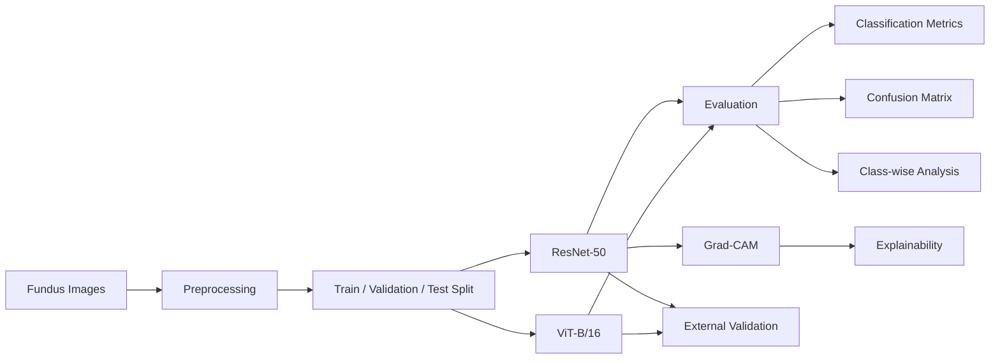

# OcuVision-AI

OcuVision-AI is a deep-learning research project that automatically recognizes and classifies multiple ocular diseases from fundus photography using convolutional and transformer-based architectures.

## Overview

This project investigates automated ocular disease recognition from fundus images using:
- **ResNet-50**
- **Vision Transformer (ViT-B/16)**

It compares their classification performance across seven distinct ocular disease classes. Explainability using Grad-CAM and external clinical validation are part of the ongoing/planned pipeline.

## Key Features

### Completed
- Fundus image classification
- 7-class ocular disease recognition
- Transfer learning with ResNet-50
- Vision Transformer comparison
- Stratified train/validation/test split
- Classification metrics (Accuracy, Precision, Recall, F1)
- Confusion matrix analysis
- Class-wise F1 analysis

### Pending
- Grad-CAM explainability
- External validation framework

## Project Pipeline



## Dataset

**Total images:** 10,449

**Classes:**
| Code | Class |
|---|---|
| N | Normal |
| D | Diabetic Retinopathy |
| G | Glaucoma |
| C | Cataract |
| A | Age-related Macular Degeneration |
| H | Hypertension |
| M | Pathological Myopia |
*(Note: Please verify full class names against the dataset documentation. Codes strictly follow the dataset labeling).*

**Split:**
| Split | Images |
|---|---:|
| Train | 8,359 |
| Validation | 1,045 |
| Test | 1,045 |

*Stratified split configured with `random_state = 42`.*

## Models

### ResNet-50
- `torchvision` ResNet-50 architecture
- ImageNet pretrained weights (`ResNet50_Weights.IMAGENET1K_V1`)
- 7-class classification head
- 224×224 input resolution
- Mixed precision training
- GPU training environment
- Checkpoint-based evaluation (`resnet50_best_checkpoint.pth`)

### Vision Transformer (ViT-B/16)
- `torchvision` ViT-B/16 architecture
- Pretrained model weights
- 7-class classifier
- 224×224 input resolution
- Optimizer: AdamW (learning rate = 1e-4, weight decay = 1e-4)
- Scheduler: ReduceLROnPlateau
- Mixed precision training

## Results

These values correspond to the existing frozen experimental runs:

| Model | Test Accuracy | Macro Precision | Macro Recall | Macro F1 | Weighted F1 |
|---|---:|---:|---:|---:|---:|
| ResNet-50 | 81.24% | 81.07% | 85.51% | 82.58% | 81.30% |
| ViT-B/16 | 77.70% | 83.08% | 79.58% | 80.61% | 77.84% |

## ResNet-50 Class-wise Results

| Class | Precision | Recall | F1 |
|---|---:|---:|---:|
| N | 0.8829 | 0.7313 | 0.8000 |
| D | 0.7157 | 0.8784 | 0.7887 |
| G | 0.8303 | 0.7611 | 0.7942 |
| C | 0.9802 | 0.9900 | 0.9851 |
| A | 0.9608 | 0.9608 | 0.9608 |
| H | 0.6429 | 0.9643 | 0.7714 |
| M | 0.6622 | 0.7000 | 0.6806 |

## ViT Class-wise Results

| Class | Precision | Recall | F1 |
|---|---:|---:|---:|
| N | 0.7082 | 0.7793 | 0.7420 |
| D | 0.7672 | 0.7476 | 0.7573 |
| G | 0.8235 | 0.6788 | 0.7442 |
| C | 1.0000 | 0.9703 | 0.9849 |
| A | 0.9796 | 0.9412 | 0.9600 |
| H | 0.9310 | 0.6429 | 0.7606 |
| M | 0.6061 | 0.8108 | 0.6936 |

## Visual Results

Please refer to the generated visual reports in the respective directories:
- **ResNet-50 Results**: `results/resnet50/`
- **ViT-B/16 Results**: `results/vit_b16/`

These folders contain generated plots including training curves, confusion matrices, classification reports, class-wise F1 graphs, and experiment summaries.

## Explainability with Grad-CAM

Grad-CAM is planned to be used to visualize image regions contributing to ResNet-50 predictions. 
- **Target layer**: `model.layer4[-1]`
- **Expected activation**: `[Batch_Size, 2048, 7, 7]`

*(Note: Grad-CAM execution is currently **PENDING**.)*

## External Validation

External/hospital dataset validation is planned/pending. The external dataset will NOT be used for training. 
The planned evaluation includes:
- Accuracy, precision, recall, macro F1
- Confusion matrix
- Domain-shift analysis

## Repository Structure

```text
OcuVision-AI/
├── README.md
├── LICENSE
├── requirements.txt
├── .gitignore
├── docs/
│   ├── HANDOVER.md
│   ├── PROJECT_ROADMAP.md
│   ├── PROJECT_STATUS.md
│   └── TROUBLESHOOTING.md
├── notebooks/
│   ├── resnet50_ocular.ipynb
│   └── vit_b16_ocular.ipynb
├── models/
│   └── README.md
├── results/
│   ├── resnet50/
│   └── vit_b16/
└── assets/
    └── README.md
```

## Getting Started

1. Clone repository.
2. Install dependencies via `pip install -r requirements.txt`.
3. Obtain the dataset separately (do not upload/push to Git).
4. Use Kaggle GPU for training/inference.
5. Attach the required dataset and PyTorch `.pth` checkpoint to the notebook.
6. Open the appropriate notebook and follow the execution blocks.

## Kaggle Workflow

Large training and inference jobs should be run on Kaggle GPU rather than local laptops.
- **Always** enable GPU.
- Attach dataset to the session.
- Upload/attach the PyTorch checkpoint (`resnet50_best_checkpoint.pth`) when needed for inference.
- Execute notebook sections in logical order.
- Download important outputs before the session expires.

**Checkpoint Warning:**
Do not confuse the PyTorch checkpoint with TensorFlow format files like `ckpt-0.index` or `ckpt-0.data-00000-of-00001`. They are strictly incompatible.

## Reproducibility

- `random_state = 42` guarantees consistent splitting.
- The exact same split is used for both models.
- Image input normalized and resized to 224×224.
- 7 classes.
- Standard ImageNet pre-training applied.
- Kaggle GPU recommended to replicate execution behavior.

## Limitations

- Class imbalance exists and may affect rarer ocular conditions.
- Possible domain shift when translating to independent hospital datasets.
- External validation pending.
- Explainability validation pending.
- Variations in fundus image quality/domain differences exist.
- Current results **should not** be interpreted as clinical deployment performance.

## Future Work

- Complete Grad-CAM visual extraction.
- External hospital validation.
- Stronger class-imbalance handling if needed.
- Additional explainability methods if clinically justified.
- Comprehensive model robustness analysis.
- Possible deployment/prototype creation.

## Project Status

### Completed
- Dataset preparation
- Preprocessing
- Stratified split
- ResNet-50 training
- ViT-B/16 training
- Internal test evaluation
- Classification reports
- Confusion matrices
- Training curves
- Model comparison
- Project documentation

### Pending
- Grad-CAM execution
- External validation
- Final report
- Final presentation
